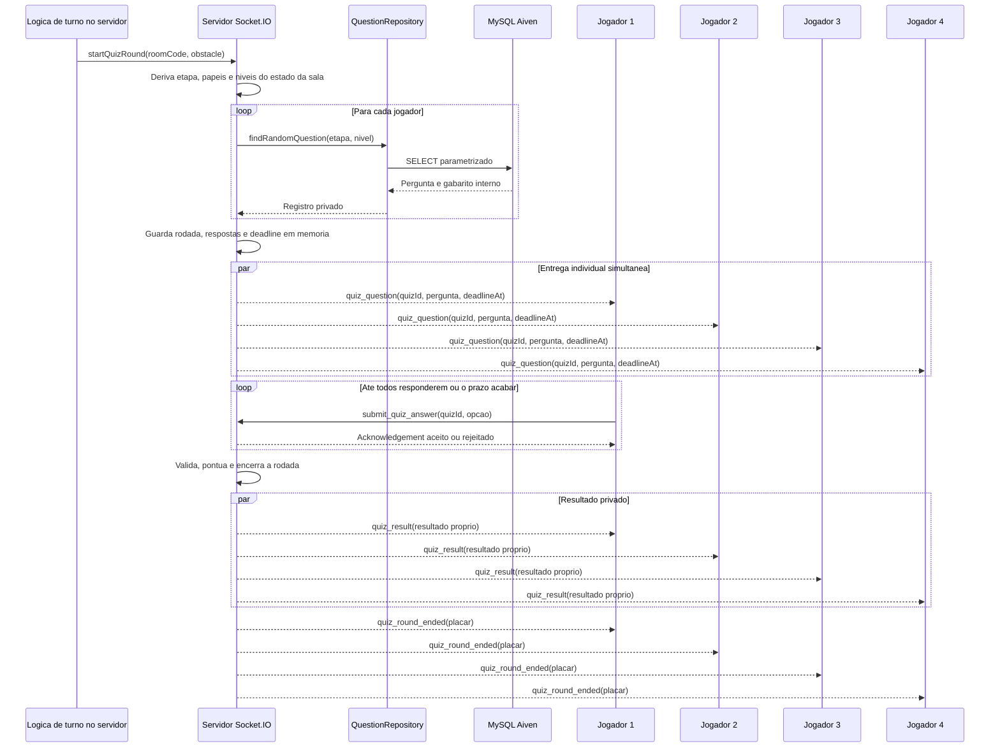

# UML e Banco de Dados — Ludo Equidade

## Objetivo

Espaço de trabalho dedicado à modelagem UML e ao desenvolvimento do banco de dados do Ludo Equidade. Vamos usar esta página para discutir alternativas, registrar decisões, organizar a sequência de implementação e preparar prompts específicos para o Gemini (arquitetura e análise) e o DeepSeek no VS Code (implementação). O Notion mantém o plano, as decisões e o estado das tarefas.

## Contexto confirmado

- O projeto está em um monorepo com frontend React Native/Expo e backend Node.js, Express e [Socket.IO](http://Socket.IO).
- Lobby para 4–8 jogadores, início manual pelo anfitrião, transferência em desconexão, papéis privados e seleção de etapa escolar foram implementados conforme relato. O Executor reportou aplicação do schema e validação real da consulta em `defaultdb` em 2026-11-09. Os testes backend (34), TypeScript e lint também passaram, este último com um aviso.
- O banco planejado é MySQL no Aiven. O PowerSoccer é referência para `mysql2/promise`, pool de conexões, variáveis de ambiente e organização do backend em módulos.
- As perguntas precisam ser filtradas por etapa escolar e nível estrutural; essas dimensões são independentes. Cada questão terá enunciado, quatro alternativas e resposta correta.
- A resposta correta deve permanecer no servidor até a validação da resposta do jogador.

## Escopo desta página

1. **Banco de dados:** modelo conceitual e lógico, tipos e restrições, índices, migrações, dados de teste e conexão com Aiven.
2. **UML:** diagramas necessários para explicar a estrutura e os fluxos relacionados à persistência de perguntas.
3. **Planejamento e prompts:** decisões pendentes, critérios de aceite, tarefas por etapa e prompts para análise ou implementação.

Fora do escopo desta página: desenho do tabuleiro e funcionalidades gerais do jogo que não dependam da modelagem ou da persistência de dados.

## Artefatos UML a produzir

- **Diagrama entidade-relacionamento:** começar pela entidade `Pergunta`; identificar se partidas, tentativas, respostas ou categorias também precisam ser persistidas antes de fechar o modelo.
- **Diagrama de classes ou componentes do backend:** representar apenas os módulos necessários à leitura e validação das perguntas, como configuração do pool, repositório e serviço; decidir se rotas/controllers ou eventos [Socket.IO](http://Socket.IO) são a interface adequada para o fluxo.
- **Diagrama de sequência:** mostrar seleção da pergunta, envio do desafio, resposta do jogador, validação no servidor e retorno do resultado, sem revelar a resposta correta antes da validação.

Os diagramas são propostas de trabalho até que as decisões correspondentes sejam registradas abaixo.

## Pendências

- Decidir se perguntas devem ser únicas dentro da mesma partida ou se podem se repetir.
- Validar o fluxo multiplayer com clientes Socket.IO reais. A integração atual foi testada com mocks/doubles; o teste de repositório usa pool simulado, embora uma consulta real em `defaultdb` tenha sido reportada.
- Antes da publicação, criar credencial de serviço do app com privilégios mínimos; nunca versionar credenciais nem dumps pessoais.

## Plano de trabalho

1. **Revisar a proposta inicial:** usar o esquema SQL e os três exemplos de teste registrados na seção 9 do [GDD - JOGO DA INCLUSAO](https://app.notion.com/p/GDD-JOGO-DA-INCLUSAO-40bc1da9eec680ff85a6ecd3f337ebfd?pvs=21) como ponto de partida; não tratar decisões ainda abertas como definitivas.
2. **Fechar o modelo de dados:** responder às decisões pendentes e desenhar o ERD.
3. **Fechar a arquitetura de acesso:** decidir módulos e fluxo backend; produzir os diagramas de classes/componentes e sequência.
4. **Preparar o banco:** validar o DDL no MySQL do Aiven, versionar migrações e inserir dados de desenvolvimento sem credenciais no repositório.
5. **Integrar e verificar:** configurar o pool com variáveis de ambiente e TLS adequado, implementar a consulta filtrada e validar que a resposta correta não é enviada antes da hora.
6. **Encerrar a fase:** documentar testes e critérios atendidos; atualizar o GDD e o Kanban com as decisões aprovadas.

## Registro de decisões

Adicionar cada decisão neste formato:

- **Decisão:**
- **Motivo:**
- **Alternativas consideradas:**
- **Impacto no modelo, UML ou implementação:**
- **Status:** proposta / aprovada / descartada

## Oficina de prompts

Para cada prompt gerado, registrar o objetivo, o contexto necessário, o arquivo ou artefato esperado, as restrições e como validar o resultado. Separar prompts de análise/arquitetura (Gemini) dos prompts de implementação (DeepSeek); não incluir segredos, credenciais ou valores reais do `.env`.

## Situação Aiven e próximos passos — atualização de 2026-11-09

### Estado atual

- Ryan confirmou em 2026-11-09 que usaremos `defaultdb` nesta etapa, informou que já fez backup do banco Power-Soccer e adiou a revisão de `ludo_equidade`. A tentativa inicial foi bloqueada pela seleção local do banco; na segunda tentativa, segundo o Executor, `SELECT DATABASE()` confirmou `defaultdb` antes de qualquer escrita.
- O repositório consulta a tabela como `FROM perguntas`, sem schema fixo; a seleção do banco fica a cargo da configuração da conexão.
- `database/schema_e_seed.sql` está versionado com a criação da tabela `perguntas` e nove questões, cobrindo cada combinação das etapas Fundamental, Médio e Superior com os níveis estruturais 1, 2 e 3. O seed evita a reinserção da mesma etapa, nível e enunciado.
- Na validação do banco antes da integração do quiz, o Executor reportou `npm test` (34 testes), TypeScript aprovado e lint sem erros, com um aviso. Após a correção de explicação opcional, a suíte backend passou 52/52 testes; TypeScript aprovado e lint sem erros, com o mesmo aviso. Também informou que aplicou o script SQL existente em `defaultdb`, validou estrutura e cobertura das nove combinações e executou uma consulta real pelo repositório; a projeção pública omitiu gabarito e explicação.
- A configuração privada foi ajustada por Ryan/Executor para selecionar `defaultdb`; nenhum segredo foi exibido. A revisão do banco `ludo_equidade` fica adiada após o backup informado do Power-Soccer. O backup não foi restaurado nem alterado.
- Ryan decidiu que, se qualquer pergunta compatível estiver ausente, o servidor não deve iniciar rodada parcial: deve emitir `QUESTIONS_UNAVAILABLE`, não pontuar e liberar a pausa para avançar o jogo.
- Ryan decidiu fixar o conjunto de N participantes no início do quiz; quem desconectar durante a rodada conta como sem resposta/zero, sem recalcular a faixa de pontos.
- Como baseline técnico para a próxima implementação, usar os eventos `quiz_question`, `submit_quiz_answer`, `quiz_result` e `quiz_round_ended`; enviá-los a sockets individuais ou à sala conforme o contrato abaixo.
- **Próximo passo:** integrar o ciclo de quiz ao estado autoritativo do lobby/motor, mantendo privado o gabarito e encerrando a pausa do obstáculo somente após concluir a rodada ou seu prazo.

### Registro anterior — 2026-11-02 (recomendação superada)

### O que sabemos

- O serviço Aiven mostrado era MySQL 8.4.11. O banco lógico `ludo_equidade` havia sido criado; seu uso foi adiado por Ryan, que confirmou `defaultdb` como alvo atual depois de informar que fez backup do banco Power-Soccer.
- Ter um único serviço Aiven não significa necessariamente ficar limitado a um único banco lógico: a Aiven permite criar bancos adicionais no mesmo serviço para separar aplicações. Um banco adicional continua compartilhando os recursos e o ciclo de vida do mesmo serviço. [[1]](https://aiven.io/docs/products/mysql/howto/create-database)
- As capturas mostram a tabela `perguntas` em `defaultdb` e em `ludo_equidade`. A consulta agregada exibida mostra uma pergunta por nível (1, 2 e 3), mas como usou `FROM perguntas` sem qualificar o banco, ainda precisamos confirmar que consultou `ludo_equidade.perguntas`.
- Um backup é uma boa precaução, mas não se deve restaurar o dump do PowerSoccer sobre o banco em uso para começar o Ludo.

### Recomendação da época (não usar como orientação atual)

O texto abaixo preserva a recomendação registrada em 2026-11-02. Ela foi superada pela informação posterior de que o app usa `defaultdb`; não execute os comandos qualificados abaixo sem confirmar o alvo atual.

Naquele momento, a recomendação era não alterar `defaultdb` e usar `ludo_equidade.perguntas`. A implementação atual não fixa o schema; selecione explicitamente `defaultdb` na conexão de aplicação e no cliente SQL antes de executar a versão atual do script.

### Segurança imediata

A captura compartilhada anteriormente expôs credenciais de conexão. O status recebido informa que a senha Aiven foi trocada e o `.env` local atualizado. Não registrar nem reenviar senhas, URI completa ou conteúdo do `.env`. Antes da publicação, planejar um usuário de serviço próprio com privilégios mínimos, em vez da conta administrativa compartilhada. [[1]](https://app.notion.com/chat?t=40cc1da9eec68082b1f200a9fe207e32) [[2]](https://aiven.io/docs/products/mysql/howto/manage-service-users)

### Evidência reportada da validação — 2026-11-09

O Executor reportou que `SELECT DATABASE()` confirmou `defaultdb` antes da escrita; a tabela e as nove combinações foram verificadas após aplicar o script. Para uma conferência independente posterior no Workbench, selecionar `defaultdb` e executar:

```sql
SELECT DATABASE() AS banco_ativo, VERSION() AS versao_mysql;
SHOW CREATE TABLE defaultdb.perguntas;
SELECT etapa_escolar, nivel_estrutural, COUNT(*) AS quantidade
FROM defaultdb.perguntas
GROUP BY etapa_escolar, nivel_estrutural
ORDER BY etapa_escolar, nivel_estrutural;
SELECT id, etapa_escolar, nivel_estrutural, enunciado,
       opcao_a, opcao_b, opcao_c, opcao_d, resposta_correta
FROM defaultdb.perguntas
ORDER BY id;
```

Esperado: `defaultdb` como banco ativo, tabela com as colunas e restrições previstas e nove combinações etapa/nível, cada uma com ao menos uma questão. Não compartilhar credenciais nem saída contendo dados sensíveis.

### Sequência de trabalho a partir daqui

- [x]  Criar o banco lógico `ludo_equidade` no serviço Aiven.
- [x]  Confirmar o schema ativo usado pelo app como `defaultdb` (informado por Ryan em 2026-11-09); as verificações de `ludo_equidade` acima são históricas.
- [x]  Rotacionar a credencial Aiven exposta na captura; a troca foi informada por Ryan. Não registrar o valor.
- [ ]  Antes da publicação, criar uma credencial de serviço própria para o app com privilégios mínimos.
- [x]  Confirmar a proposta do MVP: persistir as perguntas no MySQL e manter o estado ativo das partidas em memória no backend, aceitando que não haverá recuperação após reinício. [[1]](https://app.notion.com/chat?t=40cc1da9eec68082b1f200a9fe207e32)
- [x]  Versionar `database/schema_e_seed.sql` com criação da tabela e seeds para as nove combinações; ajustar o repositório para `FROM perguntas` e cobrir a query em teste. Testes automatizados aprovados conforme relatório do Executor.
- [x]  Selecionar `defaultdb` na configuração privada e confirmar o destino antes da escrita, conforme relatório do Executor.
- [x]  Aplicar `database/schema_e_seed.sql` em `defaultdb`; validar a estrutura, cobertura das nove combinações e consulta real do repositório, que retornou projeção pública sem gabarito/explicação. O Executor reportou sucesso em 2026-11-09.
- [x]  Integrar repositório e quiz ao fluxo disparado por obstáculo; suíte backend aprovada em 52/52 testes, incluindo questões com explicação nula. Pendente validar com clientes Socket.IO reais.

### Decisão de arquitetura para o MVP

- O MySQL em `defaultdb` guarda o banco de questões, incluindo a resposta correta para validação no servidor. A conexão deve selecionar esse banco; as consultas da aplicação não devem fixar prefixo de schema.
- O backend mantém em memória, enquanto a partida estiver ativa: salas, jogadores e papéis, turno, posições, pontuação, quiz aberto, prazo e respostas recebidas.
- O servidor é a fonte de verdade. O app recebe enunciado e alternativas; não recebe a resposta correta antes da validação.
- **Limite aceito no protótipo:** reinício ou falha do processo encerra as partidas em andamento; não haverá recuperação nem histórico persistente. Para o primeiro teste, manter uma única instância do backend.
- Reavaliar armazenamento compartilhado/persistente quando forem requisitos recuperação após desconexão/reinício, histórico, ranking ou múltiplas instâncias.

**Motivo:** reduzir o escopo do banco e entregar primeiro um ciclo jogável, aproveitando o estado de lobby já mantido em memória. **Status:** aprovada por Ryan. [[1]](https://app.notion.com/chat?t=40cc1da9eec68082b1f200a9fe207e32)

### Decisão de fluxo do quiz para o MVP

- O anfitrião escolhe no lobby uma etapa escolar (Fundamental, Médio ou Superior) antes de iniciar a partida; conforme o relato, a seleção é validada e mantida no estado autoritativo da sala, visível aos demais, obrigatória para iniciar e bloqueada após o início. [[1]](https://app.notion.com/chat?t=40cc1da9eec68082b1f200a9fe207e32)
- Baseline do primeiro ciclo, aprovada por Ryan: sortear a ordem de turnos uma vez; o servidor rola um dado de 6 lados; todos avançam em percurso linear compartilhado; somente aterrissar em casa de obstáculo abre quiz. Todos os participantes recebem simultaneamente uma pergunta individual, usando etapa e nível estrutural derivados do obstáculo e do papel.
- Adiar casas bônus/multiplicadores; guardar em memória os dados, movimentos, obstáculos e resultados de quiz para reflexão. O layout e a quantidade exata de casas ainda precisam ser definidos. [[1]](https://app.notion.com/chat?t=40cc1da9eec68082b1f200a9fe207e32)
- Os N participantes fixados no início da rodada (4 a 8) recebem perguntas individuais, usando a etapa escolar da partida e o nível estrutural correspondente ao obstáculo ativo e ao papel de cada jogador. Só enviar para sockets ainda conectados; desconexões contam como ausência/zero sem alterar N.
- O servidor controla uma janela comum de 30 segundos e aceita no máximo uma resposta por jogador.
- O gabarito permanece no servidor durante a rodada. Após validar/encerrar o quiz, o servidor informa o resultado. `explicacao` é nullable no schema e deve ser omitida do payload quando nula; sua ausência não torna a questão inválida.
- Para N participantes, respostas corretas pontuam N, N−1, ... até 1 pela ordem de recebimento do servidor. Erro ou tempo esgotado vale zero; com 4 participantes o resultado é 4, 3, 2, 1, e com 7 é 7 até 1. [[1]](https://app.notion.com/chat?t=40cc1da9eec68082b1f200a9fe207e32)
- **Status:** aprovada por Ryan e implementada no backend conforme relato do Executor em 2026-11-09. Os testes usam mocks/doubles; ainda falta smoke test com clientes Socket.IO reais. Foi identificada divergência: o validador atual exige `explicacao` não vazia apesar de a coluna permitir `NULL`; corrigir essa regra antes da validação ponta a ponta. [[1]](https://app.notion.com/chat?t=40cc1da9eec68082b1f200a9fe207e32)

## Fluxo de trabalho do código

- O Notion AI delimita cada entrega: objetivo, arquivos envolvidos, restrições, critérios de aceite e prompt.
- O DeepSeek no VS Code implementa a tarefa no repositório local; preferir mudanças pequenas e revisáveis, sem pedir ao DeepSeek para reescrever o projeto inteiro.
- Ryan revisa e executa os testes no ambiente local. Depois, compartilha aqui o diff/arquivos alterados e a saída dos testes para revisão técnica e atualização do plano.
- Para revisão inicial, fornecer a árvore do projeto, `README`, manifests e lockfiles, arquivos de entrada do backend, handlers Socket.IO, cliente Socket.IO do frontend, scripts SQL e testes pertinentes. Enviar apenas arquivos relevantes para cada tarefa.
- Não enviar `node_modules`, `.git`, builds, `.expo`, `.env`, senhas, certificados privados ou dumps reais do banco. Usar `.env.example` com valores fictícios.

## Inventário técnico do backend

- Ambiente verificado pelo DeepSeek: Node.js `v26.13.0`; backend CommonJS, sem campo `engines` no `package.json`.
- Lockfiles existentes: `backend/package-lock.json` e `frontend/package-lock.json`; atualizar o lockfile do backend ao adicionar dependência, sem criar outro.
- Dependências do backend: `cors`, `dotenv`, `express` e `socket.io`. `dotenv` já existe; adicionar apenas `mysql2` se a inspeção final confirmar que ainda falta.
- O `.gitignore` da raiz já ignora `.env`; não há `.gitignore` dentro de `backend/`. Confirmar que `.env.example` permanece versionável.
- O script `test` executa `node --test`. O teste do repositório está em `backend/test/questionRepository.test.js` (não em `backend/repositories/`). O relatório anterior à integração do quiz registrava 34 testes; após a integração, o Executor reportou 49 testes aprovados. Ambos os comandos usam `node --test`. A consulta real contra `defaultdb` foi reportada como aprovada.
- [x]  Hardening da conexão concluído conforme o relato: `DB_PORT` preenchido localmente, CA validado e `GET /api/status` real retornou HTTP 200.
- [x]  `teste-db.js` permanece não rastreado e não será usado nem comitado enquanto contiver `rejectUnauthorized: false`; lockfile do frontend fica fora do escopo.
- [x]  Questões de teste existentes em `ludo_equidade` foram confirmadas por Ryan; o banco de aplicação atual informado é `defaultdb`.
- [x]  Repositório interno `backend/repositories/questionRepository.js` concluído: filtros de etapa e nível validados, query parametrizada, colunas explícitas, retorno `null` sem correspondência e projeção pública sem resposta correta, explicação ou tags. A consulta de integração real em Aiven foi reportada pelo Executor.
- [x]  Fluxo do quiz aprovado para o MVP: de 4 a 8 jogadores respondem simultaneamente a perguntas individuais por 30 segundos; no máximo uma resposta por jogador; gabarito privado até a validação; pontos N até 1 por ordem das respostas corretas e zero para erro/tempo esgotado. [[1]](https://app.notion.com/chat?t=40cc1da9eec68082b1f200a9fe207e32)

### Contrato técnico do quiz — baseline acordado para implementação

A regra de jogo já aprovada é: de 4 a 8 perguntas individuais, entrega simultânea, 30 segundos, uma resposta por jogador, gabarito privado até a validação, pontuação N até 1 por ordem dos acertos (N = número de participantes) e zero por erro/tempo esgotado. A pessoa criadora da sala inicia manualmente quando houver de 4 a 8 participantes; essa mudança de lobby foi reportada como implementada e testada com mocks. [[1]](https://app.notion.com/chat?t=40cc1da9eec68082b1f200a9fe207e32)

- **Gatilho:** não buscar/enviar perguntas ao iniciar a partida. O estado autoritativo de turno/tabuleiro já existe; o quiz é iniciado pelo servidor somente quando uma rolagem aterrissa exatamente em uma casa de obstáculo. O cliente não escolhe nem envia papel, nível estrutural, pergunta ou gabarito.
- **Preparação:** o servidor lê etapa escolar e papéis do estado autoritativo da sala, deriva o nível pela matriz papel + obstáculo e busca uma questão para cada jogador. Primeiro obter todas as questões; não enviar nenhuma até confirmar disponibilidade para todos. Se faltar qualquer questão, emitir `quiz_error` com código `QUESTIONS_UNAVAILABLE`, não pontuar, liberar a pausa e avançar o turno.
- **Servidor → socket individual:** `quiz_question` com `quizId`, enunciado, alternativas e `deadlineAt` (timestamp absoluto). A pergunta é enviada somente ao socket do respectivo jogador; nunca transmitir gabarito, explicação ou pergunta dos demais durante a rodada.
- **Cliente → servidor:** `submit_quiz_answer` com `quizId` e alternativa `A|B|C|D`. Identificar o jogador pelo socket associado à sala, não por um `playerId` informado pelo cliente. O acknowledgement implementado retorna `{ success: true }` ou `{ success: false, code }` para rodada inválida, não participante, alternativa inválida, resposta duplicada ou prazo expirado.
- **Validação e fim:** aceitar no máximo uma resposta antes do prazo; o relógio do servidor é autoritativo. Congelar o conjunto de N participantes no início. Desconexão durante a rodada equivale a resposta ausente/zero e não altera N; encerrar quando todos os participantes ainda conectados tiverem respondido ou quando os 30 segundos terminarem. Calcular correção e pontos no servidor pela ordem de recebimento das respostas corretas.
- **Servidor → cada jogador:** após encerrar a rodada, `quiz_result` privado com resultado da própria resposta, pontos, gabarito e explicação quando disponível. Questões com `explicacao: null` são válidas; o campo é omitido do resultado. **Servidor → sala:** `quiz_round_ended` com placar público e motivo do encerramento, sem revelar respostas individuais.
- **Progressão:** a partida permanece pausada durante a rodada. Ao encerrar o quiz, acumular os pontos no estado da partida, emitir os resultados e liberar a pausa para avançar o turno; não permitir rolagem enquanto a rodada estiver pendente.
- **Compatibilidade:** verificar a convenção real de salas, sockets e estado em `server.js`, `lobby.js` e `gameEngine.js`. Não buscar/enviar perguntas no início da partida; o gatilho é o pouso em obstáculo.
- **Falha de acesso ao banco:** se a consulta falhar, não enviar perguntas parciais nem pontuar; registrar a falha no servidor sem credenciais/SQL sensível, emitir `quiz_error` com código seguro `QUIZ_UNAVAILABLE`, liberar a pausa e avançar para evitar travamento.

#### Diagrama de sequência — proposta



### Achados históricos da revisão de código — relatório de leitura do DeepSeek

- Eventos atuais: `create_room`, `join_room` e `disconnect` recebidos; `room_created`, `room_error`, `room_updated` e `game_started` enviados.
- Na revisão histórica anterior ao motor de turnos, o servidor mantinha salas em um `Map`, aceitava de 4 a 8 jogadores, aguardava início manual do anfitrião, transferia a função em desconexão, armazenava etapa escolar e entregava papéis individualmente. Naquele momento não havia estado de turno, obstáculo, pontuação ou quiz; essa lacuna foi posteriormente coberta no backend.
- **Entrada no lobby — implementação e smoke test reportados como concluídos:** `room_joined` confirma a entrada; a sala web foi testada com clientes independentes, incluindo 4 e 8 participantes, atualização de lotação e início. O relatório de 2026-11-08 registra aprovação do fluxo; ainda falta validar o app nativo via Expo Go. [[1]](https://app.notion.com/chat?t=40cc1da9eec68082b1f200a9fe207e32)
- **Privacidade dos papéis:** segundo a revisão reportada, `game_started` é enviado por socket individual, sem divulgar o mapa completo durante a partida. A revelação pública após o campeão ainda precisa ser implementada. [[1]](https://app.notion.com/chat?t=40cc1da9eec68082b1f200a9fe207e32)
- **Avatares/revelação:** proposta de nomes e avatares lúdicos durante a partida e, após o campeão, figuras humanas diversas como representações ilustrativas, não retratos dos jogadores; variar aparência sem atrelar deficiência a raça ou gênero.
- **Reflexão:** mostrar fatos da partida sobre dados/bônus, obstáculos e níveis, acertos e pontuação; estimular debate sem afirmar causalidade. Manter os indicadores em memória no MVP, sem persistir histórico. [[1]](https://app.notion.com/chat?t=40cc1da9eec68082b1f200a9fe207e32)
- O símbolo de peça de quebra-cabeça associado ao autismo é debatido; validar com a comunidade antes de adotá-lo. [[2]](https://pubmed.ncbi.nlm.nih.gov/28823194/) [[1]](https://app.notion.com/chat?t=40cc1da9eec68082b1f200a9fe207e32)
- O repositório possui teste em `backend/test/questionRepository.test.js`; os testes automatizados usam pool simulado. Além deles, o Executor reportou uma consulta de integração real em `defaultdb` e confirmou que a projeção pública não contém gabarito nem explicação.
- **Registro histórico — revisão anterior à integração do quiz:** naquele momento ainda não havia gatilho para quiz. Esse achado foi superado pela integração reportada em 2026-11-09: `backend/lobby.js` inicia o quiz ao pousar em obstáculo. A busca não ocorre no início da partida.

Os achados acima foram reportados após revisão somente de leitura, sem execução de servidor ou banco. [[1]](https://app.notion.com/chat?t=40cc1da9eec68082b1f200a9fe207e32)

- [x]  Revisão estática do servidor, repositório, testes, manifests e cliente Socket.IO concluída; teste localizado em `backend/test/questionRepository.test.js`.
- [x]  Implementar confirmação privada de `join_room` via `room_joined` e atualizar a tela do frontend; relatório: testes existentes passaram, mas sem teste ponta a ponta.
- [x]  Smoke test local via Expo Web/Socket.IO (2026-11-08): com 4 e 8 clientes, etapa obrigatória e escolhida pelo anfitrião, atualização visível, início manual, papéis privados, transferência de anfitrião e rejeição do nono; aprovado. Nenhum acesso à Aiven. [[1]](https://app.notion.com/chat?t=40cc1da9eec68082b1f200a9fe207e32)
- [x]  Confirmar o sigilo do próprio papel: cada participante sabe seu papel, mas os demais só descobrem o mapeamento após o campeão. [[1]](https://app.notion.com/chat?t=40cc1da9eec68082b1f200a9fe207e32)
- [ ]  Implementar a revelação pública do mapa jogador–papel após o campeão; o envio privado do papel individual e o suporte até 8 jogadores foram concluídos conforme relato.
- [x]  Definir máximo de 8 participantes (mínimo 4) e pontuação N até 1 entre respostas corretas; garantir uma ocorrência de cada papel e sortear repetições para participantes adicionais. [[1]](https://app.notion.com/chat?t=40cc1da9eec68082b1f200a9fe207e32)
- [x]  Definir início manual: a pessoa criadora da sala inicia quando houver de 4 a 8 participantes; não iniciar automaticamente ao chegar a quatro. Decisão aprovada e implementação reportada como concluída. [[1]](https://app.notion.com/chat?t=40cc1da9eec68082b1f200a9fe207e32)
- [x]  Definir e implementar a seleção obrigatória da etapa escolar pelo anfitrião antes do início; 20 testes backend e checagem TypeScript passaram conforme relato. [[1]](https://app.notion.com/chat?t=40cc1da9eec68082b1f200a9fe207e32)
- [ ]  Testar o app nativo via Expo Go em dispositivo Android/iOS antes de um piloto; o smoke test atual foi via Expo Web.
- [x]  Implementar lobby para 4–8 jogadores, início manual autorizado ao anfitrião, transferência do anfitrião em desconexão e distribuição privada dos papéis; Ryan reportou 20 testes passando, incluindo regras do lobby e repositório de perguntas. [[1]](https://app.notion.com/chat?t=40cc1da9eec68082b1f200a9fe207e32)
- [ ]  Repetir testes de regressão do lobby após integrar o fluxo de turnos e obstáculos.
- [ ]  Validar avatares humanos e a tela de reflexão com pessoas da comunidade e educadores; a discussão do visual específico do papel neurodivergente foi adiada por Ryan.
- [x]  Verificar a integração do repositório contra `defaultdb.perguntas`, sem compartilhar credenciais; consulta real reportada como aprovada pelo Executor em 2026-11-09.
- [x]  Definir baseline do percurso: ordem sorteada, dado de seis lados, trilha compartilhada de 0 a 20, obstáculos em 4/8/12/16, excesso limitado à chegada, limite de oito rodadas e desempates por posição/pontos. Validar ritmo e layout em playtest.
- [x]  Implementar estado autoritativo em memória para turno, movimento, obstáculos, quiz e fim de partida no backend, com testes; integração reportada em 2026-11-09 com 49 testes aprovados.
- [ ]  Validar o fluxo atualizado com clientes Socket.IO reais (preparação, pergunta privada, resposta, resultado, prazo e desconexão); os testes existentes usam mocks/doubles.
- [ ]  Planejar a tela final com métricas observadas de sorte/movimento, obstáculos e níveis enfrentados e desempenho matemático, sem afirmar causalidade ou generalizar experiências.