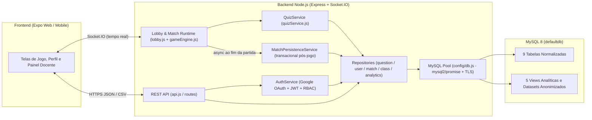
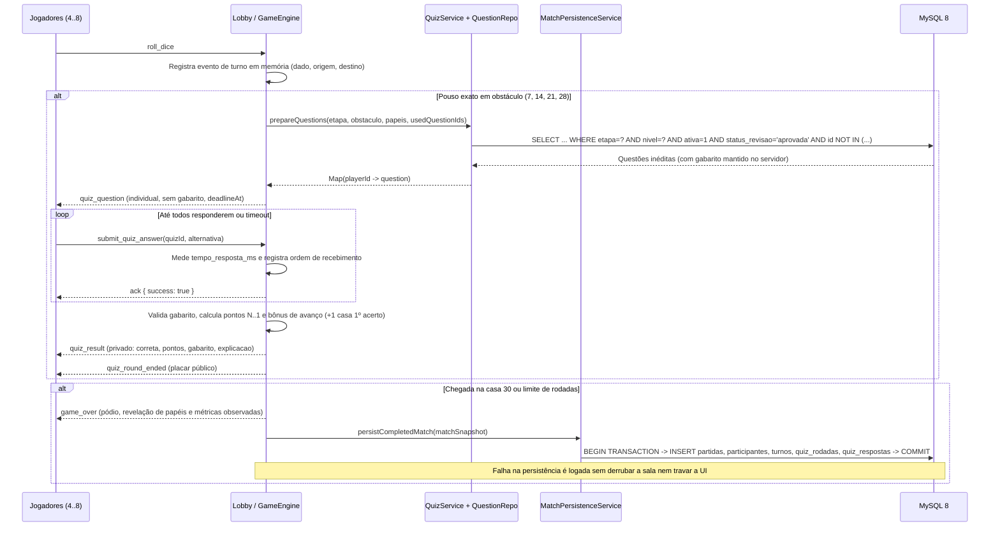

# UML, Modelagem de Dados e Base Estatística — Ludo Equidade (v2.0)

- **Atualizado em:** 2026-11-21
- **Banco alvo:** MySQL 8.0 / 8.4 (`InnoDB`, `utf8mb4_unicode_ci`), 100% portável (sem recursos proprietários de provedor)
- **Estado em produção (v1.0):** `defaultdb` no Aiven com **27 perguntas únicas balanceadas** (3 por célula `etapa_escolar × nivel_estrutural`).
- **Scripts versionados:** [database/README.md](../database/README.md) · [001](../database/migrations/001_schema_base_perguntas.sql) · [002](../database/migrations/002_usuarios_turmas_partidas_analytics.sql) · [003](../database/migrations/003_views_analiticas.sql)

---

## 1. Filosofia da Modelagem (Jogo + Pesquisa ICE-UFRRJ)

A arquitetura de dados do Ludo Equidade v2.0 foi desenhada sob **três princípios simultâneos**:

1. **Baixa latência em tempo real:** o estado *ativo* da sala e da partida (turnos em andamento, cronômetro de 30–60s, reconexão de 60s) permanece em memória no servidor Node.js. A gravação no MySQL ocorre de forma transacional ao encerrar a partida (`game_over`), garantindo que oscilações do banco nunca travem o gameplay.
2. **Valor científico para Estatística, Probabilidade e Inferência (ICE-UFRRJ):** cada partida, participação, turno estocástico, rodada de quiz e resposta individual (com latência em ms) é persistida em modelo normalizado (3FN), permitindo estudos de Cadeias de Markov, Teoria Clássica dos Testes (TCT), Teoria de Resposta ao Item (TRI) e modelos inferenciais sobre equidade.
3. **Privacidade por Design (LGPD / CEP):** dados civis identificáveis vivem exclusivamente em `usuarios`. Todas as views analíticas e exportações utilizam `participante_anon_id` (pseudonimização) e filtram explicitamente `consentiu_pesquisa = 1`.

---

## 2. Diagrama Entidade-Relacionamento (ERD — v2.0)

```mermaid
erDiagram
    usuarios ||--o{ turmas : "cria (professor)"
    usuarios ||--o{ matrizes_equidade : "cria"
    usuarios ||--o{ perguntas : "cria / revisa"
    usuarios ||--o{ partidas : "anfitriao"
    usuarios ||--o{ partida_participantes : "participa (opcional)"

    turmas ||--o{ partidas : "agrupa"
    matrizes_equidade ||--o{ partidas : "parametriza"

    partidas ||--|{ partida_participantes : "tem"
    partidas ||--o{ partida_turnos : "registra"
    partidas ||--o{ quiz_rodadas : "dispara"

    partida_participantes ||--o{ partida_turnos : "executa"
    partida_participantes ||--o{ quiz_respostas : "submete"

    partida_turnos ||--o| quiz_rodadas : "origina"
    quiz_rodadas ||--o{ quiz_respostas : "coleta"
    perguntas ||--o{ quiz_respostas : "aplicada em"

    usuarios {
        int id PK
        char36 uuid UK
        varchar google_sub UK
        varchar email UK
        varchar nome
        varchar apelido_padrao
        varchar avatar_padrao
        enum papel_sistema "jogador | professor | admin"
        tinyint consentimento_pesquisa
        datetime consentimento_em
        tinyint ativo
    }

    turmas {
        int id PK
        int professor_id FK
        varchar codigo UK
        varchar nome
        varchar instituicao
        enum etapa_padrao
        tinyint ativa
    }

    matrizes_equidade {
        int id PK
        varchar codigo UK
        varchar nome
        json configuracao_json
        tinyint ativa
        int criado_por FK
    }

    perguntas {
        int id PK
        enum etapa_escolar "Fundamental | Medio | Superior"
        tinyint nivel_estrutural "1 | 2 | 3"
        text enunciado
        varchar opcao_a
        varchar opcao_b
        varchar opcao_c
        varchar opcao_d
        enum resposta_correta "A | B | C | D"
        text explicacao
        json tags
        char64 enunciado_hash UK "GENERATED STORED"
        varchar area_tematica
        varchar codigo_bncc
        enum status_revisao "rascunho | em_revisao | aprovada | arquivada"
        tinyint ativa
        int criado_por FK
        int revisado_por FK
    }

    partidas {
        bigint id PK
        char36 uuid UK
        char4 room_code
        int turma_id FK
        int matriz_id FK
        int anfitriao_usuario_id FK
        enum etapa_escolar
        tinyint modo_privado
        smallint quiz_duracao_seg
        tinyint max_rodadas
        tinyint total_jogadores
        tinyint rodadas_jogadas
        enum motivo_fim "finish | round_limit | abandoned"
        tinyint elegivel_pesquisa
        datetime iniciada_em
        datetime finalizada_em
        int duracao_seg
    }

    partida_participantes {
        bigint id PK
        bigint partida_id FK
        int usuario_id FK "NULL se convidado"
        char36 participante_anon_id
        varchar apelido_partida
        enum condicao "cadeirante | cego | surdo | neuroatipico"
        tinyint ordem_turno
        tinyint posicao_final
        smallint pontos_quiz
        tinyint vencedor
        tinyint destaque_quiz
        smallint rolagens_dado
        smallint soma_dados
        decimal media_dado
        tinyint impulsos_ativados
        tinyint obstaculos_ativados
        tinyint quizzes_respondidos
        tinyint quizzes_corretos
        tinyint nivel1_enfrentados
        tinyint nivel2_enfrentados
        tinyint nivel3_enfrentados
        tinyint desconectou
        tinyint consentiu_pesquisa
    }

    partida_turnos {
        bigint id PK
        bigint partida_id FK
        bigint participante_id FK
        smallint numero_turno
        tinyint rodada
        tinyint valor_dado "1..6"
        tinyint posicao_anterior
        tinyint posicao_pouso
        tinyint posicao_final
        tinyint ativou_impulso
        tinyint ativou_obstaculo
        varchar obstaculo_nome
        datetime ocorrido_em
    }

    quiz_rodadas {
        bigint id PK
        bigint partida_id FK
        bigint turno_id FK
        char36 quiz_uuid UK
        tinyint rodada_partida
        tinyint posicao_obstaculo
        varchar obstaculo_nome
        tinyint participantes_n
        enum motivo_fim
        datetime iniciada_em
        datetime finalizada_em
    }

    quiz_respostas {
        bigint id PK
        bigint quiz_rodada_id FK
        bigint participante_id FK
        int pergunta_id FK
        enum condicao
        tinyint nivel_estrutural
        enum alternativa_marcada "A | B | C | D | NULL"
        tinyint correta
        int tempo_resposta_ms
        tinyint ordem_recebimento
        tinyint pontos_obtidos
        tinyint avanco_bonus_casas
        tinyint desconectado
        datetime respondido_em
    }
```

---

## 3. Diagrama de Componentes de Acesso a Dados (Backend)

---

## 4. Diagrama de Sequência — Quiz Simultâneo e Persistência Pós-Partida

---

## 5. Views Analíticas e Potencial para Pesquisa (ICE — UFRRJ)

As 5 views criadas em [003_views_analiticas.sql](../database/migrations/003_views_analiticas.sql) estruturam os dados diretamente para perguntas de pesquisa em Matemática, Estatística e Probabilidade:

| View | Granularidade | Uso principal | Exemplos de análises possíveis |
| --- | --- | --- | --- |
| `vw_desempenho_perguntas` | 1 linha por questão | Painel de Professores / Psicometria | Índice de facilidade ($p$), taxa de omissão/timeout, tempo médio de resposta e frequência dos distratores (`A/B/C/D`). |
| `vw_equidade_por_condicao` | `etapa × matriz × condição` | Painel de Professores / Equidade | Comparação de taxa de vitória, posição média, sorte no dado vs. desempenho no quiz entre os 4 papéis. |
| `vw_matriz_empirica` | `etapa × matriz × obstáculo × condição × nível` | Calibração da Matriz de Equidade | Testar estatisticamente se o salto de complexidade entre Nível 1, 2 e 3 se reflete em taxa de acerto e latência. |
| `vw_dataset_anonimo_participacoes` | 1 linha por participação consentida | Exportação CSV/JSON (R / Python) | Regressão logística (`vencedor ~ condicao + media_dado + quizzes_corretos + ordem_turno`), testes não-paramétricos (Kruskal-Wallis, Mann-Whitney). |
| `vw_dataset_anonimo_respostas` | 1 linha por resposta consentida | Exportação CSV/JSON (R / Python) | Teoria de Resposta ao Item (modelo de Rasch / 2PL), análise de sobrevivência / distribuição do `tempo_resposta_ms`, modelos lineares mistos. |

---

## 6. Decisões de Engenharia Registradas

| Decisão | Escolha | Justificativa |
| --- | --- | --- |
| **Deduplicação de perguntas no banco** | Coluna gerada `enunciado_hash CHAR(64) STORED` com `UNIQUE INDEX` | Como `enunciado` é `TEXT`, índice único direto exigiria prefixo arbitrário. O hash SHA-256 normalizado (`etapa \| nível \| LOWER(TRIM(enunciado))`) garante integridade exata no MySQL 8. |
| **Retrocompatibilidade da tabela `perguntas`** | `ALTER TABLE` apenas adicionando colunas com defaults seguros (`ativa = 1`, `status_revisao = 'aprovada'`) | Mantém as 27 questões em produção e o `questionRepository` atual funcionando sem ruptura. |
| **Separação de PII e Analytics** | `usuarios.id` opcional (`NULL` para convidados) + `participante_anon_id` em `partida_participantes` | Permite jogar sem cadastro, suporta histórico autenticado e garante exportações 100% anonimizadas conforme LGPD. |
| **Versionamento da Matriz** | Tabela `matrizes_equidade` com `configuracao_json` + FK em `partidas` | Evita misturar dados coletados sob regras diferentes caso a matriz seja calibrada durante a pesquisa. |
| **Portabilidade de Provedor** | SQL padrão MySQL 8 (`InnoDB`, `utf8mb4`), sem extensões proprietárias | Mantém o banco atual no Aiven durante as apresentações e torna uma migração futura (antes de 2026-12-21) um dump/restore simples. |

---

## 7. Histórico Resumido da Evolução do Banco

- **2026-11-02 a 2026-11-09:** definição inicial do MVP com estado de jogo em memória e tabela `perguntas` em `defaultdb` (MySQL 8.4 no Aiven); criação de `database/schema_e_seed.sql` com 9 questões cobrindo as 9 combinações `etapa × nível`.
- **2026-11-16 a 2026-11-20:** adição da API REST (`backend/api.js`), expansão para **27 perguntas únicas balanceadas** (`database/perguntas_expansao.sql` tornado idempotente e com gabarito do ID 14 corrigido para `C`), prevenção de repetição na mesma partida (`usedQuestionIds`) e métricas observadas em memória (`76/76` testes aprovados).
- **2026-11-21:** evolução da modelagem para **v2.0** (9 tabelas + 5 views analíticas + controle `schema_migrations`) voltada à apresentação institucional no ICE-UFRRJ, contemplando Google OAuth, Painel de Professores, Turmas, Matriz versionada e datasets anonimizados para pesquisa científica.
